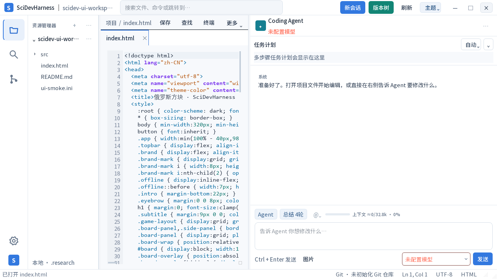

# SciDevHarness

**面向本地项目的 Windows AI 编程工作台。**

在同一窗口中浏览项目、让 Agent 修改代码、运行检查，并审核 Git 变更。支持本地模型和兼容 API，桌面端与 CLI 共用同一套执行、验证和会话记录。

[](https://github.com/ljk00000/SciDevHarness/actions/workflows/ci.yml)


[](LICENSE)



*Paper 浅色主题下的演示工作区。可切换 Studio、Focus 主题，并调整分栏、字体和缩放。*

[快速开始](#快速开始) · [模型接入](#模型接入) · [CLI 与扩展](#cli-与扩展) · [技术手册](docs/SCIDEV_HARNESS.md) · [问题反馈](https://github.com/ljk00000/SciDevHarness/issues)

## 核心能力

| 能力 | 可以做什么 |
|---|---|
| Agent 编码 | 检索项目、读取文件、维护任务计划、修改代码并执行检查。 |
| 编辑与审核 | 使用文件树、代码编辑器和集成终端；逐块审核补丁，在 diff 中查看修改。 |
| 模型接入 | 连接支持工具调用的兼容 API，或使用 Ollama、LM Studio、llama.cpp 本地服务。 |
| Git 与版本树 | 查看差异和提交，以开发版本树追踪尝试，使用 worktree 隔离任务。 |
| 会话与上下文 | 恢复会话，按任务检索相关代码，引用本项目已完成任务的总结。 |
| CLI 与工具扩展 | 无界面执行任务，接入 MCP 工具和生命周期 hooks，运行固定题集评测。 |

完整功能、执行边界与实现状态见[技术手册](docs/SCIDEV_HARNESS.md#能力与技术架构)。

## 快速开始

需要 **Windows、Python 3.12–3.14 和 Git CLI**，以及一个可用的模型服务。

### 1. 获取源码并启动

```powershell
git clone https://github.com/ljk00000/SciDevHarness.git
cd SciDevHarness
.\start_client.bat
```

也可在资源管理器中双击 `start_client.bat`。启动器会检查项目的 `.venv`，按需创建环境并安装 `requirements.txt`；已有环境的 Python 版本不兼容时会提示处理。

### 2. 打开项目并配置模型

首次启动默认打开 `examples/tetris` 示例；之后会恢复最近使用的工作区。使用项目栏“⋯”或 `Ctrl+K`、`Ctrl+O` 在新窗口打开其他项目，也可指定路径：

```powershell
.\start_client.bat --workspace "D:\Projects\my-project"
```

点击 Agent 面板中的“未配置模型”或输入区模型下拉，打开“模型接入”。填写服务地址、模型名称和 API Key 后保存；本地服务按其要求填写 Key。

### 3. 提交第一个任务

先尝试了解项目：

> 概括当前项目的入口、主要模块和运行方式。

再选择一个具体问题，让 Agent 提出方案、修改代码并运行项目已有检查。修改后可在 Git 面板审核 diff；已有文件的补丁会按当前审批设置处理。

## 模型接入

| 接入方式 | 最小配置 |
|---|---|
| 兼容 API | 在“模型接入”中填写 API Base URL、模型名称和 API Key。服务需支持 OpenAI-compatible Chat Completions 和 function/tool calling。 |
| 本地模型 | 启动 Ollama、LM Studio 或 llama.cpp 服务后，使用本地探测或填写对应兼容地址和已安装的模型名称。 |

通过界面保存的 API Key 写入 Windows 凭据管理器，项目配置只记录地址、模型及其他非敏感字段。任务上下文和图片附件会发送到所选模型服务。

已有 Ollama 模型时，可使用本地启动器：

```powershell
$env:SCIDEV_MODEL="your-installed-ollama-model-tag"
.\start_qwen_local.bat
```

该脚本检查已有模型并设置本次进程的连接参数。更多环境变量、任务预算、总结和视觉审查配置见[模型接入与网络配置](docs/SCIDEV_HARNESS.md#模型接入与网络配置)。

## 典型工作流

```text
打开项目 → 选择模型与执行策略 → 提交任务
        → 查看计划和工具输出 → 运行检查
        → 审核补丁与 Git diff → 提交或继续修改
```

执行策略提供只读、手动审批、工作区可写和完全访问。启用自动提交时，Agent 会按验证规则处理任务，并仅纳入本次任务改动的文件；已有改动仍由你管理。隔离任务可使用独立 worktree。

策略、命令白名单、网络权限及 Docker 后端见[桌面功能与执行策略](docs/SCIDEV_HARNESS.md#桌面功能与执行策略)。

## CLI 与扩展

使用项目虚拟环境，无需打开桌面窗口：

```powershell
.\.venv\Scripts\python.exe -m scidev.cli exec `
  --workspace "D:\Projects\my-project" `
  --task "修复这个项目的一个边界条件问题，并运行已有测试" `
  --execution-mode workspace-write `
  --json
```

查看全部子命令可运行 `.\.venv\Scripts\python.exe -m scidev.cli --help`。CLI 支持会话恢复、worktree、PR、环境诊断和评测；MCP、hooks 与独立验收按配置启用。

详见[命令行参考](docs/SCIDEV_HARNESS.md#命令行参考)、[上下文、规划与验收](docs/SCIDEV_HARNESS.md#上下文规划与验收)。

## 开发与项目结构

```text
scidev/       应用代码：agent、desktop、workspace、integrations、runtime、evaluation
scripts/      启动准备、测试、冒烟与发布工具
tests/        自动化测试
ui/           QML 与图标资源
docs/         技术手册、当前工作与历史结果
evals/        固定评测题集与基线
examples/     示例项目
packaging/    Windows 安装器配置
```

根目录 `scidev_client.py`、`scidev_cli.py` 保留为兼容启动入口；桌面端也可通过项目解释器运行 `python -m scidev`。实现代码使用 `scidev.*` 包路径。

开发环境安装 `requirements-dev.txt` 后，可从仓库根目录运行：

```powershell
.\.venv\Scripts\python.exe -B scripts/run_tests_coverage.py
```

CI 检查 Python 3.12、3.13、3.14，执行静态检查、测试、依赖冒烟与后台布局截图。详细验证步骤见[测试与后台截图](docs/SCIDEV_HARNESS.md#测试与后台截图)。

Windows 独立版使用仓库外暂存目录构建；核心调用为 `pyside6-deploy --config-file pysidedeploy.spec --nuitka-version=4.1.1`。完整工具链、暂存、安装器和签名步骤见[开发与发布](docs/SCIDEV_HARNESS.md#开发与发布)。

## 文档与项目状态

| 入口 | 内容 |
|---|---|
| [技术手册](docs/SCIDEV_HARNESS.md) | 模型配置、操作参考、CLI 参数、执行策略、模块架构与发布步骤。 |
| [历史与结果](docs/HISTORY_RESULTS.md) | 已完成改动、回归结果、已知问题与阶段记录。 |
| [当前工作](docs/CURRENT_WORK.md) | 当前任务与后续准备。 |
| [Issues](https://github.com/ljk00000/SciDevHarness/issues) | 报告问题；请附复现步骤、环境版本及脱敏后的错误信息。 |

当前重点是 Windows 桌面与 CLI 的编码闭环；自动科研实验流程属于后续方向。具体能力与支持范围以[实现状态](docs/SCIDEV_HARNESS.md#能力状态总表)为准。

## 许可证

项目代码采用 [Apache-2.0](LICENSE)。本仓库不含 Qt/PySide6 运行时二进制，也不分发模型权重；Qt/PySide6 社区版组件涉及 LGPLv3、GPLv3 等许可证，模型使用各自许可证。独立程序的分发要求见[许可证与第三方组件](docs/SCIDEV_HARNESS.md#许可证与第三方组件)。
