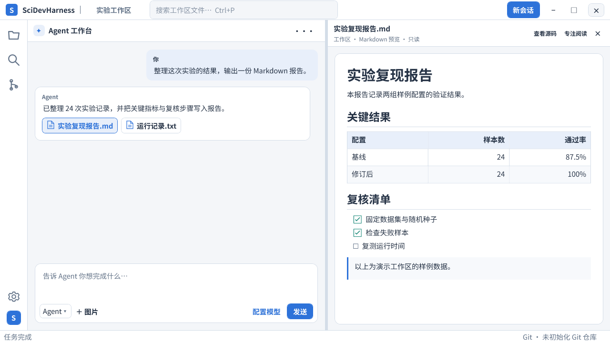
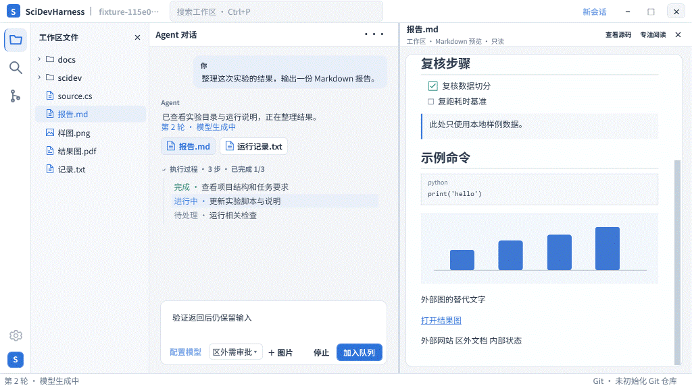

# SciDevHarness

**面向本地项目的 Windows AI 编程工作台。**

在同一窗口中交给 Agent 编码任务、浏览项目文件、阅读产物并审核 Git 变更。桌面端采用 C# / WPF，与 CLI 共用任务执行、权限策略和会话记录。

[](https://github.com/ljk00000/SciDevHarness/actions/workflows/dotnet-prototype.yml)


[](LICENSE)



*Paper 浅色主题下的演示工作区。点击 Agent 的产物卡即可在对话旁阅读 Markdown 报告。*

<details>
<summary>观看工作台动效（开发版）</summary>



</details>

[快速开始](#快速开始) · [模型接入](#模型接入) · [CLI 与扩展](#cli-与扩展) · [文档](#文档与项目状态) · [问题反馈](https://github.com/ljk00000/SciDevHarness/issues)

## 核心能力

| 能力 | 可以做什么 |
|---|---|
| Agent 编码 | 查找项目内容、维护任务计划、修改工作区文件，并按配置运行检查。 |
| 文件树与阅读 | 浏览源文件和目录，阅读 Markdown、PDF 和常见图片。右键可用只读纯文本打开源文件。 |
| Markdown 排版 | 渲染标题、表格、代码块、任务清单和本地图片，支持切换源码和专注阅读。 |
| Git 与审核 | 查看差异、审核补丁、暂存文件、提交和使用独立 worktree。 |
| 模型接入 | 连接支持工具调用的兼容 API，或使用本地模型服务。 |
| CLI 与扩展 | 无界面执行任务、查看历史、连接 MCP 工具和运行评测。 |

## 快速开始

### 1. 获取源码并启动

从源码运行需要 **Windows 和 .NET 10 SDK**：

```powershell
git clone https://github.com/ljk00000/SciDevHarness.git
cd SciDevHarness
.\start_client.bat
```

### 2. 打开项目并配置模型

启动后直接进入工作台。应用优先恢复最近使用的工作区，也可从顶部项目菜单切换，或在源码启动时指定目录：

```powershell
.\start_client.bat --workspace "D:\Projects\my-project"
```

点击输入区的「配置模型」，填写 API 地址和模型名称，再按服务商要求设置凭据。

### 3. 提交第一个任务

> 概括当前项目的入口、主要模块和运行方式，整理成一份 Markdown 文档。

任务完成后，点击回复里的产物卡查看报告。也可以从文件树双击 Markdown，或右键选择「预览 Markdown」。右侧阅读区支持查看源码，PDF 支持翻页和缩放。

## 模型接入

| 接入方式 | 最小配置 |
|---|---|
| 兼容 API | 填写服务商提供的 API Base URL、模型 ID 和 API Key。服务需支持 OpenAI-compatible Chat Completions 与工具调用。 |
| 本地模型 | 启动 Ollama、LM Studio 或 llama.cpp 的兼容服务，填写本机地址和已经加载的模型 ID。 |

从桌面保存的 API Key 由 Windows 凭据管理器保管。CLI 可读取进程环境中的 `SCIDEV_API_KEY`。任务上下文与附件会发送到所选模型服务。

## 典型工作流

```text
打开工作区 → 选择模型与权限 → 提交任务
         → 查看计划与工具结果 → 审核修改 → 阅读产物
```

默认使用工作区审批策略。额外联网、访问工作区外文件和运行宿主命令各有独立审批设置。Docker 用于隔离命令执行，可按需配置。未配置 Docker 时，Agent 仍可完成文件任务，任务结果会标记验证未运行。

## CLI 与扩展

从仓库根目录运行。执行模型任务前，在当前 PowerShell 会话设置 `SCIDEV_API_KEY`，并填入服务地址和模型 ID：

```powershell
dotnet run --project dotnet/src/SciDev.Cli -- doctor --workspace "D:\Projects\my-project"
dotnet run --project dotnet/src/SciDev.Cli -- exec `
  --workspace "D:\Projects\my-project" `
  --api-base "https://provider.example/v1" --model "your-model-id" `
  --task "找到入口并整理项目说明" `
  --execution-mode workspace-approval --json
```

已安装版本也可在安装目录的 `Cli` 子目录运行 `SciDev.Cli.exe`。用 `--help` 查看历史、迁移、Git、MCP 和评测命令。

## 开发与项目结构

```text
dotnet/src/SciDev.Desktop/         WPF 工作台与文档阅读
dotnet/src/SciDev.Cli/             命令行入口
dotnet/src/SciDev.Core/            Agent 循环、策略与任务协议
dotnet/src/SciDev.Infrastructure/  文件、模型、Git 与持久化
dotnet/tests/                      .NET 回归、离线回放和安装验收
scidev/                            旧版 Python 实现
scripts/                           启动、辅助工具与打包
docs/                              使用参考与迁移记录
```

```powershell
dotnet build dotnet/SciDevHarness.slnx
dotnet dotnet/tests/SciDev.Tests/bin/Debug/net10.0/SciDev.Tests.dll
```

[C# CI](.github/workflows/dotnet-prototype.yml) 验证构建、启动器、离线任务和 Python 兼容场景。[Windows 打包](.github/workflows/csharp-preview-package.yml) 验证自包含安装包、无 Docker 文件任务和卸载流程。

## 文档与项目状态

| 入口 | 内容 |
|---|---|
| [C# 迁移说明](docs/CSHARP_MIGRATION.md) | 新旧版功能对应、数据迁移和验收记录。 |
| [Python 版技术手册](docs/SCIDEV_HARNESS.md) | 旧版桌面、CLI 和配置参考。旧版可用 `start_python_client.bat` 启动。 |
| [当前工作](docs/CURRENT_WORK.md) · [历史与结果](docs/HISTORY_RESULTS.md) | 发布验收和阶段记录。 |
| [Issues](https://github.com/ljk00000/SciDevHarness/issues) | 报告问题时请附复现步骤、版本和脱敏后的错误信息。 |

## 许可证

项目代码采用 [Apache-2.0](LICENSE)。第三方库和用户自行接入的模型沿用各自许可证。

源码仓库不含 Qt/PySide6 运行时二进制。旧版 Python 使用的 Qt/PySide6 社区版组件涉及 LGPLv3、GPLv3 等许可证，详见[第三方组件说明](docs/SCIDEV_HARNESS.md#许可证与第三方组件)。
