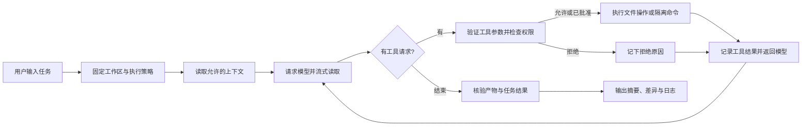

# SciDevHarness C# 迁移方案

**2026-11-23 17:32（Asia/Shanghai）· 默认入口切换。** 0.1.14 是 GitHub 主线的 C# 版本。源码以 `start_client.bat` 进入 WPF 工作台，Python 兼容入口为 `start_python_client.bat`。发行流程先验收干净安装和卸载，再上传 Windows x64 安装器及 SHA-256。原 Python 安装和项目数据沿用各自位置。

**2026-11-19 19:50（Asia/Shanghai）· 方案已完成，实施待开始。** 当前目标是把 Windows 桌面版、CLI 和 Agent 迁到 C#。先用 CLI 跑通任务和审批，再迁 WPF 界面。预览阶段保留 Python 版作为行为对照和回退入口。

**2026-11-19 19:57（Asia/Shanghai）· 方案复核。** 保留技术栈。补齐工具执行后崩溃的恢复规则、旧设置的导入边界和安装包的补丁策略；把终端和编辑器原型提前到正式重写前验证。

## 1. 技术选型和工程边界

采用 [.NET 10 LTS](https://dotnet.microsoft.com/en-us/platform/support/policy) 和 [WPF](https://learn.microsoft.com/en-us/dotnet/desktop/wpf/overview)。本机已确认安装 .NET SDK `10.0.402`。新工程独立放在 `dotnet/`，首个发布目标为 Windows x64。WPF 负责 Windows UI，核心库不引用 WPF；如果将来需要跨平台，可另换桌面层。

WPF 适合现有的多面板 Windows 工作台和安装流程。[WinUI 3](https://learn.microsoft.com/en-us/windows/apps/windows-app-sdk/) 可在 Fluent 控件或 Windows App SDK 功能成为硬需求时再评估。[Avalonia](https://docs.avaloniaui.net/docs/supported-platforms) 适合明确要求 macOS/Linux 桌面版的情况；届时凭据、终端和隔离后端仍需分别移植。兼容旧 Windows 的范围按 [.NET 平台支持表](https://learn.microsoft.com/en-us/dotnet/core/install/windows#supported-versions) 和实际安装测试确定，预览版先验证受支持的 Windows 11 x64。

如果迁移目标主要是打包或维护成本，M0 先测现有版本的冷启动、内存、安装体积、构建和升级；模型响应耗时单独记录。只有全量迁移的收益明确，才承诺补齐整套桌面功能。

| 新工程 | 接收现有职责 | 第一批交付 |
| --- | --- | --- |
| `dotnet/src/SciDev.Core` | `scidev/agent` 的任务循环、工具定义、计划、取消和验收；`runtime/policy.py` 的策略决策 | 每次运行有独立状态；统一工具执行入口；输出带 `run_id` 的事件供 CLI 和 WPF 消费 |
| `dotnet/src/SciDev.Infrastructure` | `integrations` 的模型与协议，`workspace` 的 Git/补丁/检查点，`runtime` 的进程/沙箱/持久化 | OpenAI 兼容接口、文件工具、Docker 后端、日志和本地凭据适配 |
| `dotnet/src/SciDev.Cli` | `scidev/cli.py` 的参数、退出码、JSON 和交互审批 | 先交付 `exec`、`doctor`、`sandbox-check`，其余命令逐批按现有行为补齐 |
| `dotnet/src/SciDev.Desktop` | `scidev/desktop` 和 `ui/` 的工作台 | WPF + MVVM，先迁聊天、停止、补丁和审批，再迁项目浏览、编辑器、终端等 |
| `dotnet/tests/SciDev.Tests` | `tests/` 和 `scripts/` 中可移植的行为验收 | 单元、契约、集成测试；两版共用脱敏测试样本，禁止解析结果时依赖 UI 控件 |

`Core` 定义模型、工具执行、审批和事件存储接口，`Infrastructure` 实现接口，CLI/WPF 负责装配和展示。按变更职责组织代码，不按 Python 文件名逐个翻译；两端共用一个 Agent 和一套审批规则。

## 2. 一次任务在 C# 版里的流程



停止请求贯穿模型读取、审批等待和子进程执行。取消、超时和失败各有明确结果；已经发生的工具操作保留审计记录，按本次运行配置决定是否恢复改动。达到轮次或预算限制时正常收尾，不把未验收的产物标成通过。

## 3. 分阶段交付

每阶段独立交付，达到本阶段的验收条件后再进入下一阶段。M0 先列清现有功能的使用情况，再估算工期；终端、编辑器和发布验证单独估算。

| 阶段 | 做什么 | 进入下一阶段的条件 |
| --- | --- | --- |
| **M0 冻结基线** | 用保留当前未提交改动的源码快照记录 Python 行为。列出工具、执行模式、CLI 参数/退出码、事件类型和已知失败。功能标记为切换必需、可延后或明确退役。建立脱敏样本和技术验证清单。 | Python 在隔离工作区跑出可重放样本；已知失败与预期结果有记录；没有未分类的高风险行为；明确平台范围和保留功能。 |
| **M1 C# CLI 跑通** | 创建解决方案和 Windows CI；实现 Agent 最小循环、流式模型、`read_file`/`write_file`、日志和结果 JSON。实现最小工作区限制，先用临时工作区验证，暂不开放模型命令执行。并行制作独立的编辑器和终端原型，不接入正式应用。 | 离线回放覆盖工具顺序、文件、验收和退出码，也能跑一次需要读取旧文件再修改的任务；实际 DeepSeek 留下可读日志和产物；原型验证中文输入、关闭终端和编辑大文件，足以决定依赖。 |
| **M2 安全与数据** | 迁移权限、审批、Git/diff、检查点、会话与事件存储。扩展 CLI 兼容测试，验证终止、重跑和失败恢复。Docker 提供可选的隔离命令执行。 | 默认流程验证工作区边界、逐次审批、旧数据导入和备份恢复。配置 Docker 的流程另外验证断网隔离和取消清理。 |
| **M3 WPF 工作台** | 按顺序接入工作区、模型设置、聊天/队列/停止、审批和补丁，再迁文件树、搜索、编辑器/分屏、Git/worktree、终端和主题。 | 从桌面完成任务、拒绝或批准操作、重新打开会话并看到结果；后台测试四档分辨率和缩放，关键按钮、文本与弹窗都可见且可操作。 |
| **M4 补齐功能并发布预览** | 对照 M0 清单补齐验收和评测、MCP 客户端/服务端、LSP、图像附件/预览、PR 与更新等现有能力，逐项标记支持状态。构建独立安装包。 | 无未说明的功能差异；遇到不能立即迁的功能，记录影响、Python 入口和补齐条件。干净 Windows 环境通过安装、运行、升级、卸载和回退。 |
| **M5 切换默认入口** | 预览期使用项目副本或独立 worktree。预览完成后，切换快捷方式、README 和发布流程，保留最后一个可用的 Python 安装包。 | 主要用户流程、权限、数据兼容全部通过，阻断问题清零，完成至少一次真实回退演练。Python 运行依赖在达到这些条件后再从默认安装包移除。 |

## 4. 安全、模型与数据的硬要求

**审批和沙箱。** 保留现有 [执行模式](SCIDEV_HARNESS.md) 的语义和 CLI 选项。`workspace-approval` 下，工作区内文件经统一路径验证后交给文件工具，新建文件可落盘，已有文件继续走补丁审阅（CLI 保持其显式补丁策略）。宿主命令、访问区外路径和 Agent 工具联网要逐次请求；区外文件工具请求直接拒绝，需要访问时走明确的宿主操作审批。批准绑定到本次操作，审批窗口展示操作内容、路径及其可能带来的区外访问或联网，执行前再次确认目标未变。无交互、拒绝或超时时都不执行。

默认配置的容器镜像留空，模型和工作区文件任务可正常使用。代码改动的结果记录尚未运行检查。显式配置 Docker 时，容器断网，工作区以只读方式挂载，临时目录可写。镜像或引擎不可用时返回失败，宿主命令始终走独立审批。需要生成构建缓存的测试在容器临时副本执行。Windows 文件操作验证实际打开的目标，覆盖符号链接、目录联接、路径大小写、不存在的目标，以及审批期间目标发生变化的情况。Git、钩子、浏览器、MCP 等能力接入同一策略，用户手动操作和 Agent 发起的操作分别审计。

批准外部读写时优先提供有明确目标和范围的专用操作。仅在用户明确批准运行宿主命令后才启动宿主进程；这种批准允许该进程以当前用户身份运行，不能保证它只做命令描述里提到的事。子进程采用必要环境变量白名单；不继承模型密钥，不给容器挂载宿主凭据。外部文件获准读取后，若其内容还要发送至远程模型，需在审批时说明目的地和数据范围；该许可不能从读文件权限自动推导。

**模型与日志。** 用 `HttpClient` 的 [`ResponseHeadersRead`](https://learn.microsoft.com/en-us/dotnet/api/system.net.http.httpcompletionoption?view=net-10.0) 读取 SSE，单独约束流读取超时及取消。保留 DeepSeek/OpenCode Go 的 OpenAI 兼容配置、工具片段拼接、用量和首事件/整轮耗时；重试有限且避免重复执行已完成工具。用户选定的模型端点连接与 Agent 发起的额外联网是两类入口。默认直连；直连失败且确有必要时才启用代理，并限制重试、并发、速率和超时。真实鹈鹕对照保持 `max_tokens=12000`（端点支持时），不自动下载模型或大镜像。

**凭据和数据。** 沿用 Windows Credential Manager 的凭据标识；CI 只用假密钥和模拟服务，测试环境变量提供的假密钥不会传给工具子进程。API Key 不进仓库、命令行、回放、日志或安装包。项目数据清单包括 `.research/` 下的 `settings.json`、`provider.json`、会话、事件、`runs.db` 和检查点；另把 PySide6 `QSettings` 里的主题和布局列入桌面偏好。C# 用 `System.Text.Json` 和 [Microsoft.Data.Sqlite](https://learn.microsoft.com/en-us/dotnet/standard/data/sqlite/) 读取副本，显式映射字段、默认值和版本。旧 Qt 布局格式不兼容时保留原值，重新生成 WPF 布局。

预览期两版使用独立状态目录。导入时暂停写入，使用 [SQLite 备份接口](https://sqlite.org/backup.html) 取数据库快照，和会话、日志及检查点一起验证。固定旧版读入、导入后读写和回退三条测试。只有经实测确认 Python 能读回的版本才允许共享写入；需要新 schema 时写入新目录，保留原目录和新增会话导出，以便回退。遇到未知新版时拒绝改写。

**崩溃恢复。** 原版已用工具调用日志区分待执行、已启动和已完成。C# 记录同一工具调用的标识、执行阶段和结果：结果已保存时复用；看见已启动但无法确认结果时，先报告并核对实际状态，不自动重跑可能产生改动的操作。这条规则和故障注入测试在 M2 验收，尤其要覆盖“文件已经写入，但会话尚未保存”。

## 5. 验收样例和发布门槛

| 验收 | 最少覆盖 |
| --- | --- |
| 鹈鹕回归（离线） | 复用 [`scripts/smoke_pelican_svg.py`](../scripts/smoke_pelican_svg.py) 的固定提示词和规则。用模拟 SSE 分别回放结构完整和缺少部件 ID 两条轨迹。比较工具调用、文件、验收结论、事件及退出码；忽略时间戳等非确定字段。现有预览用 Qt SVG，初期仍可用 Python 验收器独立对照；移除 Python 运行依赖前，验证 C# 的 SVG 渲染和安全限制，测试预览不加载外部资源。 |
| 鹈鹕实测（手动） | 单次接 DeepSeek 验证实际流式协议，保留脱敏过程日志、SVG、PNG 和结果。现有基线是 6 次请求、168.8 秒、图能渲染，但因缺少 17 个指定部件 ID 未过严格验收（见 [历史与结果](HISTORY_RESULTS.md)）。分别记录模型请求、文件写入、渲染及严格验收结果；不要求两次模型产物逐字相同。 |
| 安全与恢复 | 默认发布验收在镜像为空时验证文件写入、未执行检查的标记、区外拒绝、宿主命令不可用及数据恢复。原生回归覆盖链接、一次批准不可复用、取消后进程清理与脱敏。可选 Docker 功能单独核对断网、只读及不可用时的行为。 |
| 桌面与终端 | 后台截图验证 720p、1080p、2K、4K，并测试缩放和窗口拉伸。模型和终端输出在后台缓冲后批量刷新 UI；测试高频输出时仍能停止任务和操作窗口。[ConPTY](https://learn.microsoft.com/en-us/windows/console/creating-a-pseudoconsole-session) 与终端显示分开验证，重点是关闭时继续排空输出、取消后清理进程，以及退出码、中文输入和缩放。编辑器先试 [AvalonEdit](https://github.com/icsharpcode/AvalonEdit)，验证大文件、差异标记和跳转后再定。Ruff/TS LSP 保持外部进程；Jedi 和 `pdb` 列为独立的 Python 项目能力，明确保留、替换或延后的方案。 |
| 发布 | Windows CI 在现有 Python 流水线旁运行 C# 构建和离线测试；真实模型仅手动运行。用 [自包含发布](https://learn.microsoft.com/en-us/dotnet/core/deploying/) 产出 `win-x64` 目录供 Inno Setup 打包，沿用现有签名检查；运行时安全补丁发布后安排重新构建和签发。在干净 Windows 上确认核心流程不依赖 Python、.NET Runtime 或 .NET SDK 的预安装；Git、Docker 和项目语言工具链按功能检查。预览版单独标识和发布，旧版更新检查不得误推 C# 预览包。 |

切换前保留 Python 安装包、原配置入口和最后一份状态备份。预览安装包用独立安装标识和快捷方式。若审批行为、会话读取或核心任务回归出问题，停止默认切换，回到 Python 入口，恢复已验证的数据副本；先保留 C# 期间新增的会话和日志，避免回退覆盖新记录。工作区源码与状态文件分开处理，以便保留用户的实际改动。

## 6. 实施起点

**2026-11-19 20:39（Asia/Shanghai）· M1 离线门槛通过，真实模型验收有阻塞。** 工程入口是 [`dotnet/SciDevHarness.slnx`](../dotnet/SciDevHarness.slnx)。`exec` 可读取 UTF-8 文件、创建及迭代本轮新文件。已有文件通过 `apply_patch` 提交一处精确修改：默认拒绝，交互终端可加 `--patch-approval review` 逐次确认。命令、联网工具、Git 和自动恢复尚未对 Agent 开放，原型仍限实验工作区。

**2026-11-19 20:46（Asia/Shanghai）· 实测定位。** 保持 12,000 token 上限复跑，模型返回 `finish_reason=length`，已用完 12,000 输出 tokens。CLI 拒绝执行该轮工具。

**2026-11-19 21:10（Asia/Shanghai）· 真实模型流程通过，严格产物验收待补。** 同一提示词将单次上限提高到 20,000 后，CLI 生成可辨认的 SVG 并正常收尾。独立验收仍因缺少 17 个部件 ID 失败。CLI 的 `completed` 表示任务循环完成，严格通过由独立验收结果决定。下一步在离线回放中接入验收反馈，验证模型按反馈修改本轮文件并再次验收。

WPF/AvalonEdit 编辑器和 ConPTY 已单独验证。M2 先实现了诊断入口：`doctor` 检查运行环境，`sandbox-check` 用本地镜像跑固定隔离测试，`migrate --dry-run` 盘点 Python 数据副本，`inspect-run` 标出崩溃后需要复核的工具。旧数据导入、Agent 命令执行、完整桌面工作台和发布切换尚未开始验收。

在仓库根目录复跑：

```powershell
dotnet build dotnet/SciDevHarness.slnx
dotnet dotnet/tests/SciDev.Tests/bin/Debug/net10.0/SciDev.Tests.dll
python dotnet/tests/smoke.py
# 已装原版 Qt 依赖时，附加两条严格 SVG 验收对照：
.venv/Scripts/python.exe dotnet/tests/smoke.py --oracle
```

CLI 把最终状态作为 `--json` 输出，过程写入实验工作区的 `.research/csharp-<run_id>.jsonl`。运行真实模型时，在进程环境提供 `SCIDEV_API_KEY`，用 `--api-base` 和 `--model` 选择端点；OpenCode Go 按[官方要求](https://opencode.ai/docs/console/go/#where-can-i-use-it)使用稳定会话标识和自身客户端名称。未提交或保存任何真实密钥。继续工作和验证结果见 [当前工作](CURRENT_WORK.md) 与 [历史与结果](HISTORY_RESULTS.md)。

**2026-11-19 21:40（Asia/Shanghai）· 严格产物验收接入。** `exec` 的 `--pelican-validator` 指定仓库里的 `scripts/csharp_pelican_validator.py`，`--validator-python` 指定安装了 Qt 的可信 Python；两者都应位于本次任务工作区之外。只通过 stdin 传递本轮产物字节，不传模型凭据。验收失败时最多把具体验收问题交还模型两次；`replace_in_file` 支持同轮新文件的批量精确修改，任一项匹配失败整批不写入。严格模式的 `acceptance` 字段单独记录通过、失败或运行环境错误。此桥接用于迁移对照，仍依赖 Python 验收器。

**2026-11-19 21:44（Asia/Shanghai）· 真实修补闭环通过，几何验收仍有阻塞。** 两次反馈促使模型在同一文件补齐所有 17 个 ID。达到 8 轮上限后独立核验最终 SVG，发现仍有 6 项几何问题；CLI 已补上轮次用尽时的最终版本验收。下一步用本次 SVG 固定问题样本，迁移定向几何修补提示，再做真实验收。

**2026-11-19 22:20（Asia/Shanghai）· 真实严格验收通过。** 针对验收发现的问题生成具体部件指导；模型写回修补后马上复验。真实 DeepSeek 在第 4 轮第一次修补就通过原版几何检查。M2 继续验证数据副本导入和沙箱边界。

**2026-11-19 22:26（Asia/Shanghai）· 历史快照导入通过。** 使用 `migrate --workspace <停写的 Python 工作区副本> --snapshot <新目录>`，复制会话、事件和配置，并以 SQLite 备份形成独立历史。临时副本保留待合并的 WAL 记录，源数据无旁路文件。当前不导入检查点和桌面 `QSettings`；完整容器回归仍需已准备的本地工具链镜像。可同时保留 Python 原状态和 C# 快照。

**2026-11-19 22:53（Asia/Shanghai）· M2 恢复和隔离项目命令。** 默认记录 C# 文件写入前的检查点。用 `inspect-run` 查阅中断，显式运行 `restore-run --workspace <目录> --run-id <ID>` 撤销，或在 `exec` 加 `--restore-on-failure`。恢复只处理当前身份和摘要吻合的任务改动，报告用户编辑、文件丢失和写入冲突。旧检查点导入后保留清单及备份，供查看和回退核对。

实验工作区可在 `exec` 加 `--sandbox-image <本机镜像>`，启用容器内 `run_command`。命令以参数列表传入 Linux 容器，在断网、只读快照的临时副本中执行，缓存随容器销毁。快照排除隐藏目录、链接和常见凭据文件；上限为 4,096 个目录项、单文件 16 MiB、总计 64 MiB。命令最长 90 秒。宿主进程和区外操作审批、Git、Qt 偏好导入仍待迁移。

**2026-11-19 23:25（Asia/Shanghai）· 区外审批与工作台入口。** CLI 加 `--outside-approval review` 或在 WPF 勾选区外文件审批。每次先确认打开指定文件，再确认精确替换或发送预览，界面会显示发送的模型地址。执行前按实际打开的文件验证身份与摘要。已批准的区外写入需单独恢复。带区外数据的模型回复仅在运行时显示，历史保留审批记录和状态。 [Win32 文件句柄](https://learn.microsoft.com/en-us/windows/win32/api/fileapi/nf-fileapi-createfilew)

用 `history --workspace <目录>` 查看新旧会话，旧会话详情用 `inspect-run --source python --workspace <目录> --run-id <ID>`。WPF 已纳入解决方案，构建后运行 `dotnet dotnet/src/SciDev.Desktop/bin/Debug/net10.0-windows/SciDev.Desktop.dll --workspace <实验目录>`。支持选工作区、模型设置、运行、停止和审批，文件树、编辑器与终端待接入。

**2026-11-19 23:46（Asia/Shanghai）· 编辑器与只读 Git。** WPF 支持查找文件、使用 AvalonEdit 编辑、按磁盘版本条件保存。Git 状态与差异是用户操作，读取普通本地仓库的元数据副本。链接工作树与 Git 写入尚待迁移。 [Git 状态输出](https://git-scm.com/docs/git-status)

**2026-11-19 23:58（Asia/Shanghai）· 手动终端与模型凭据。** WPF 终端由用户启动，运行在宿主工作区，提供逐行输入、文本输出、尺寸调整和进程树清理。用户可在 WPF 点「项目模型」复用保存的配置和 Windows 凭据。CLI 支持 `--credential-profile <名称> --api-base <地址>`。 [ConPTY 会话](https://learn.microsoft.com/en-us/windows/console/creating-a-pseudoconsole-session) · [Windows 凭据读取](https://learn.microsoft.com/en-us/windows/win32/api/wincred/nf-wincred-credreadw)

**2026-11-20 00:01（Asia/Shanghai）· 链接工作树读取。** CLI 的 `git-status` 和 `git-diff` 可用 `--metadata-workspace <主仓库目录>` 批准本次查询。程序核对工作树和主仓库互相指向的记录后再读取索引、引用和对象。WPF 逐次弹出主仓库选择器，原 Git 元数据保留在原处。

**2026-11-20 00:18（Asia/Shanghai）· 桌面偏好与 Git 暂存。** 用 `scripts/export_qt_preferences.py --output <新 JSON 文件>` 导出旧桌面主题和窗格比例，也可用 `--ini <旧配置副本>`。WPF 的「导入外观」和 CLI 的 `migrate --snapshot ... --qt-preferences ...` 接收该文件。WPF 将旧比例转换成当前文件窗格宽度，并原样保存其余比例。CLI `git-stage`、`git-unstage` 和 WPF 的对应按钮支持选中路径，链接工作树仍须逐次指定主仓库。遇到占用中的索引锁或必须执行清理过滤器的文件时停止暂存。

**2026-11-20 00:26（Asia/Shanghai）· 预览包入口。** 从已还原 win-x64 运行时包的环境运行 `./scripts/publish_csharp_preview.ps1 -Version 0.1.0 -OutputDirectory dist/csharp-preview`。首次还原可在有依赖缓存或获准下载时指定 `-Restore`。预览安装器使用独立产品 ID、安装目录与快捷方式，产物仅从手动 CI 验证任务获取。已本地验证两种安装器模板。CI 实际构建、签名、干净 Windows 下安装升级及回退仍待验收。 [自包含发布](https://learn.microsoft.com/en-us/dotnet/core/deploying/) · [Inno Setup 产品标识](https://jrsoftware.org/inno-setup/documentation/topic_setup_appid.htm)

**2026-11-20 00:39（Asia/Shanghai）· 任务队列和模型重试。** WPF 使用 `.research/desktop-queue.json` 保存待处理任务。运行时可追加，顺序完成后自动执行已确认的下一项。停止或失败时暂停。重开后需点击「继续队列」确认按当前模型和权限运行；已开始且未确认完成的记录可查历史或取回提示词。模型 HTTP 429、502、503 和 504 最多重试两次，等待超出 10 秒时结束本轮。发送同一轮请求时保留前序工具结果。 [Retry-After](https://www.rfc-editor.org/rfc/rfc9110#section-10.2.3)

**2026-11-20 00:49（Asia/Shanghai）· 手动模式容器审批。** WPF 选「手动审批」并填写已有镜像。CLI 使用 `--execution-mode manual --sandbox-image <镜像> --command-approval review`，从交互终端逐次确认。审批显示工作区、固定的镜像 ID 和完整参数。执行使用审批前生成的断网临时副本，日志记录参数摘要、调用 ID 和审批决定。CLI 无交互时阻止手动命令。手动模式的宿主命令仍在迁移清单。 [Docker 运行参数](https://docs.docker.com/reference/cli/docker/container/run/)

**2026-11-20 00:58（Asia/Shanghai）· WPF 编辑器分屏。** 点「分屏」可让同一份草稿在左右窗格显示，或从文件树右键「在右侧打开」并排查看其他文件。两侧能分别切换标签和移动光标，同一文件共享撤销历史。合并将右侧标签移回左侧。保存全部逐文件核对磁盘版本，遇到冲突保留草稿并处理其他文件。 [AvalonEdit 撤销历史](https://github.com/icsharpcode/AvalonEdit/blob/master/ICSharpCode.AvalonEdit/Document/UndoStack.cs)

**2026-11-20 01:13（Asia/Shanghai）· 本地 Git 提交。** WPF 点击「提交暂存」查看目标分支和暂存文件，再填写提交说明和身份。CLI 提供 `git-commit-preview --workspace <目录>` 与 `git-commit --workspace <目录> --message <说明> --name <姓名> --email <邮箱>`。链接工作树仍需指定主仓库。确认后在索引锁保护下核对暂存区和父提交，创建提交对象，再更新已审核的本地分支引用。签名、提交钩子、分离 HEAD 和合并续作交由本地 Git 处理。 [Git 提交对象](https://git-scm.com/docs/git-commit-tree) · [Git 引用更新](https://git-scm.com/docs/git-update-ref)

**2026-11-20 01:31（Asia/Shanghai）· Git 工作树。** WPF 的 Git 页可查看列表、新建并打开独立窗口。CLI 提供 `git-worktree-list`、`git-worktree-create` 和 `git-worktree-remove`。附加 `exec --worktree --worktree-id <id>` 时，任务从当前提交检出到 `.research/worktrees/<id>`，JSON 返回路径、分支和基线 SHA。回收限于干净的托管目录，并保留分支和提交记录。配置外部检出过滤器的仓库以及需要强制回收的工作树通过本地 Git 处理。 [Git 工作树](https://git-scm.com/docs/git-worktree)

**2026-11-20 01:38（Asia/Shanghai）· 工作区可写模式。** 在 WPF 选「工作区可写」，或在 CLI 加 `--execution-mode workspace-write --sandbox-image <已有镜像>`。符合规则的测试、静态检查与类型检查在断网容器中自动运行，其余容器命令逐次确认。CLI 通过 `--command-approval review` 启用交互确认。日志记录自动检查类别、镜像 ID 和参数摘要。此模式的宿主命令仍在后续清单。

**2026-11-20 01:50（Asia/Shanghai）· 额外联网审批。** WPF 勾选「额外联网审批」，CLI 使用 `--network-approval review`。仅向符合公网地址检查的 HTTPS 域名直连，先逐次审核完整 URL，再审核最多 8,192 个 UTF-16 代码单元的文本预览及模型地址。响应上限 64 KiB，超时 12 秒，关闭重定向和代理。日志保存调用标识、URL 摘要和决定。后台桌面已完成公网 GET 和本机模拟模型往返。 [IANA IPv4 特殊用途地址](https://www.iana.org/assignments/iana-ipv4-special-registry/iana-ipv4-special-registry.xhtml) · [IANA IPv6 特殊用途地址](https://www.iana.org/assignments/iana-ipv6-special-registry/iana-ipv6-special-registry.xhtml)

**2026-11-20 02:05（Asia/Shanghai）· 工作区发现。** Agent 的 `list_files` 和 `search_code` 可用于 CLI、WPF 和只读任务。文件搜索支持作用域、glob、大小写和邻近行，限制扫描时间、字节数和输出。读取前校验文件身份，代码搜索跳过链接、受保护路径、非 UTF-8 和超限文件。使用工作区内的 `.gitignore` 与普通仓库的 `.git/info/exclude`。Git 索引上的跟踪状态、全局忽略配置和链接工作树主仓库的排除项仍待对照。 [Git 忽略规则](https://git-scm.com/docs/gitignore)

**2026-11-20 02:15（Asia/Shanghai）· 按需项目上下文。** `get_project_context` 可指定文件、目录和关键词。读取项目清单及锁文件，提取常见运行时和依赖声明、静态命令候选、虚拟环境的版本字段、适用 `AGENTS.md` 和带行号的相关片段。候选不会自动执行。代码片段遮蔽密钥时保留行号。当前为文件快照，任务启动自动附带、Git 状态、未保存缓冲和完整清单语义对照待完成。

**2026-11-20 02:24（Asia/Shanghai）· 启动上下文和编辑器草稿。** 首轮模型请求在用户任务前附带最多 9,000 字符的工作区摘要。会话日志只记录摘要长度、草稿数量或读取失败状态。WPF 确认后优先捕获当前文件，最多 8 份草稿，每份 256 KiB、合计 1,000,000 字节。读取、搜索和上下文使用同一份只读快照，超限文件的旧磁盘内容被排除。文件写入和补丁申请会拒绝草稿文件，容器副本跳过这些文件。含草稿的运行结果仅当场显示，历史保存提示。

**2026-11-20 02:33（Asia/Shanghai）· Git 上下文与目录说明。** 进程内校验并读取 Git 索引 2/3/4 版。搜索保留已跟踪的忽略文件，保护路径、链接及未跟踪的忽略文件继续排除。摘要在预算内比对可见文件的原始字节和索引对象，无需启动 Git。完整状态可从现有 CLI 和桌面 Git 入口查看。提交比较、内容过滤、拆分和稀疏索引及全局忽略仍待对照。进入新目录或说明变化时，先返回适用的 `AGENTS.md`，模型收到后才能继续该目录写入。 [Git 索引格式](https://git-scm.com/docs/gitformat-index)

**2026-11-20 02:45（Asia/Shanghai）· 任务计划和最终代码验证。** WPF 默认「自动计划」，CLI 默认关闭，可用 `--planning-mode auto|required|off`。必需模式要求先建立计划，再执行其他工具；遗留未完成步骤不能结束。计划可实时查看及从会话重开。代码改动默认需通过可识别的离线检查，证据绑定实际 Docker 副本，文件变化或草稿导致的输入缺失会使证据无法通过。CLI 可用 `--no-verify`，WPF 可关闭「完成前验证」。目前由模型发起检查及有限补验，Harness 自动选择命令及结构化诊断仍待迁移。

**2026-11-20 02:56（Asia/Shanghai）· 自动验证与结构化诊断。** 在工作区审批或工作区可写模式，缺少当前验证证据时，从覆盖此次改动的项目清单选取一个测试、静态检查或类型检查。每类每个改动版本至多一次，总计至多三次。通过已有断网容器执行，运行目录取自清单所在目录。pytest、Ruff/mypy、TypeScript、编译器及 Node TAP 的常见失败输出可提取相对路径、行列、级别和错误码，修复后重新验证最终副本。多个子项目无共同检查清单时留给模型选择。

**2026-11-20 03:18（Asia/Shanghai）· 原生 SVG 验收。** CLI 任务使用 `exec --pelican-native` 可用 C# 渲染检查代替 Python 桥接。它读取本轮保存的产物，检查部件 ID、轮轴与车架、骑乘姿态及画布中的可见像素。拒绝 DTD、活动元素和外部资源，支持本地渐变和简单样式。独立复核和导出预览用 `check-pelican --svg <样本.svg> --preview <新文件.png>`。Qt 对照覆盖固定样本和四份已保存的 DeepSeek 产物。发布前仍需覆盖更多模型输出和绘图语法差异。 [SVG.NET](https://www.nuget.org/packages/Svg/3.4.8)

**2026-11-20 03:33（Asia/Shanghai）· 跨项目检查及历史摘要。** 每个改动按最近的项目清单目录归属，独立子项目分别保留验证证据。任务最多自动运行三次，先为各项目安排第一项检查。需要补验时可通过 `run_command.directory` 指定相对目录，命令仍使用断网容器副本。最后一个项目通过后才满足完成门槛。CLI 与 WPF 历史可读旧报告的状态、类别和退出码，新报告另显示已通过及待验证目录。

**2026-11-20 03:44（Asia/Shanghai）· 批量暂存及工作树对照。** CLI `git-stage-all --workspace <目录>` 和 WPF「暂存可见改动」使用同一个索引锁事务。链接工作树写入仍须批准主仓库。Git 忽略项、受保护路径和冲突项排除在批量操作之外。检测到受保护路径删除时，先单独核对可能关联的新增项。普通仓库副本中，两版的状态、所测差异、暂存索引和工作树基线一致。 [Git 状态格式](https://git-scm.com/docs/git-status) · [Git 暂存](https://git-scm.com/docs/git-add)

**2026-11-20 03:59（Asia/Shanghai）· Agent Git 审阅。** 工作台与启用 `--git-approval review` 的交互 CLI 按次审批 `git_diff`。本机只读固定查询使用元数据副本和经过筛选的文件快照。普通仓库审批时显示模型目的地。链接工作树先指定主仓库，再另行批准发送实际预览。审计记录决定、计数及摘要哈希。 [Git 仓库和工作树路径选项](https://git-scm.com/docs/git)

**2026-11-20 04:13（Asia/Shanghai）· Git 初始化。** 工作台可直接初始化独立目录，CLI 用 `git-init --workspace <目录> [--initial-branch <初始分支>]`，默认 `main`。在同一工作区内先准备仓库元数据，再一次发布到 `.git`。隔离继承的 Git 设置及模板，已有仓库复用原分支、配置和索引。独立工作区已通过首次暂存与提交。 [Git 初始化选项](https://git-scm.com/docs/git-init)

**2026-11-20 04:31（Asia/Shanghai）· 任务结束后提交。** 工作台「完成后提交」及 `exec --auto-commit review` 在任务成功后分别批准本机 Git 检查和本轮实际差异。本地提交保留既有暂存项及本轮之前的改动；超出预览上限、受保护、已忽略和混有更早修改的文件跳过。分支、所选文件或暂存区在审阅期间变化时停止。发布中断可用 `inspect-run` 核对。

**2026-11-20 04:37（Asia/Shanghai）· Node 与 Go 清单。** Node 沿用显式包管理器或最近的锁文件，跳过占位脚本与冲突锁文件。Go 测试归属最近的模块，父模块缺少自有测试时不生成候选。其余语言继续比对。

**2026-11-20 04:49（Asia/Shanghai）· 自包含预览包。** 已构建 Windows x64 的 0.1.0 与 0.1.1 未签名安装包。两版 CLI 从发布目录读到旧会话，新版工作台通过四档后台渲染。本机尝试安装时，开始菜单和 HKCU 卸载注册表写入收到错误 5，已核对安装回滚清理。包验证工作流已加入复装旧版预览、读取旧 Python 会话及核对数据摘要的步骤，等待干净 Windows 环境执行。

**2026-11-20 05:05（Asia/Shanghai）· 测试证据。** Python、Rust、JVM 从工作区的测试源码生成候选。.NET 可沿显式 `ProjectReference` 找到测试项目，在容器工作区副本中重查引用。识别到零项或无法确认的测试结果时，验证保持待完成。Node 已完成真实断网容器对照，其他运行时仍待同等端到端复核。 [VSTest 退出码说明](https://learn.microsoft.com/en-us/dotnet/core/tools/dotnet-test-vstest)

**2026-11-20 05:22（Asia/Shanghai）· 宿主命令与白名单。** `--host-approval review` 或工作台「宿主命令审批」启用 `run_host_command`。绝对 EXE 路径、分开的参数及工作区内工作目录经过校验。检查 EXE、启动和分享输出分别获准。启动绑定已打开文件及摘要，进程加入 Windows 作业，停止或超时结束进程树。获批程序以当前用户权限运行，其文件副作用不由工作区检查点追踪。`--allowed-commands 'npm run check; dotnet build'` 适用于配置了本地镜像的工作区可写模式，对断网容器的参数前缀逐词匹配。 [Windows 进程属性](https://learn.microsoft.com/en-us/windows/win32/api/processthreadsapi/nf-processthreadsapi-updateprocthreadattribute) · [Windows 作业对象](https://learn.microsoft.com/en-us/windows/win32/procthread/job-objects)

**2026-11-20 05:35（Asia/Shanghai）· 旧版权限。** `migrate --dry-run` 显示旧设置及命令前缀计数。CLI 用 `--use-legacy-policy`，工作台点「项目权限」并确认预览，显式应用本项目设置。CLI 的执行模式、镜像、白名单及 `--network-policy ask|deny` 可单独指定。`deny` 禁止额外 HTTPS 及可能联网的宿主进程，保留模型连接与断网容器。原 `local` 仅保留为旧后端记录，宿主命令仍需单独审批。原 `allow` 载入为逐次审批，原 `full-access` 需要手动选择支持的模式。独立快照和桌面切换已验收。

**2026-11-20 05:43（Asia/Shanghai）· 旧版容器命令。** 显式应用旧策略后，`run_command` 接受旧 `command`、`timeout_seconds` 和 `outside_workspace=false`。命令文本交给断网容器的 shell，常规参数仍可参与白名单及验证分类。已单独验证普通参数、重定向、内建命令与超时清理。

**2026-11-20 05:56（Asia/Shanghai）· 旧版宿主命令。** 应用旧策略、选择工作区审批模式并显式开启宿主审批后，`run_command` 的 `outside_workspace=true` 接受单行 Windows 命令。系统 `cmd.exe` 的检查、执行原文、输出发送分别审批。断网策略拒绝该调用。仍拦截识别出的破坏性命令和 Harness 所管理的 Git 变更。容器失败不会触发宿主执行。

## 7. 切换验收台账

**2026-11-20 07:05（Asia/Shanghai）**

| 阶段 | 已核验 | 待核验 |
| --- | --- | --- |
| M0 | Python 88 项对照及入口文件指纹已保存，已有 CLI 启动基线、桌面新进程启动及空闲内存基线 | 冷文件缓存桌面启动、Python 安装包体积与构建基线 |
| M1 | DeepSeek 鹈鹕严格验收、C# 原生 SVG 与 Qt 样本对照、离线 SSE、审批补丁、编辑器和终端原型、目录浏览与搜索、项目上下文及未保存编辑保护、任务计划、最终文件验证、跨项目自动检查、Cargo 工作区聚合和排除包证据、MSBuild 条件式导入与文本属性候选及实际构建证据、Windows SDK 缓存还原、断网 .NET 还原流程夹具、零测试保护、真实 Python、Maven 和 Gradle 通过及失败修复、结构化诊断 | 扩展 SVG 判定对照、需要完整 MSBuild 求值的动态候选、真实 Linux .NET 和 Rust 核验、在 Windows CI 复核构建与离线回放 |
| M2 | 只读、本机 Docker、手动容器审批、工作区可写模式的断网验证及白名单、显式完全访问、新旧宿主命令三次审批、旧项目权限、旧容器命令和断网策略、检查点恢复、有限模型重试、区外文件及公网 HTTPS 文本双审批、旧数据与 Qt 偏好导入、当前项目旧状态副本、C# 会话续接、CLI 和桌面 Python 旧会话续跑回归、旧凭据读取、Git 初始化、状态及差异、逐项和批量暂存、本地分支提交、任务结束后双审批提交、原工作树续接及 Agent Git 差异审批、正式工作区临时文件写入、Node 验证、已有文件审批及恢复 | 其余联网操作、多语言验证 |
| M3 | WPF 核心任务、持久化队列、取消、审批、历史、文件查找、编辑器分屏与批量保存、Git 差异、暂存、本地提交与工作树窗口、终端 VT 屏幕和实时输入、本机 PowerShell 与 Vim 验收、Python pdb 调试、三套主题四档后台截图 | 更多全屏程序兼容性、中文输入法和四档 DPI 实机操作 |
| M4 | 预览打包入口、独立安装标识、脚本输入校验、两种 Inno 模板编译、0.1.7 Windows x64 自包含产物、发布目录 EXE 的无 Docker 默认流程和工作台渲染、四格式图片附件、批量评测与报告、本地文本工具套件 3/3、标准容器回放 20/20、指定测试编辑与独立验收、工作区重命名及成对恢复和提交、MCP 只读服务、stdio 与 HTTP 查询、Agent 调用及结果审批、GitHub PR CLI 查询、审阅、预演、推送和创建、桌面 PR 查询与审阅、CLI 和桌面更新器离线验收、WPF 的 Ruff 和 TypeScript 诊断、Jedi 补全与定义 | 真实发布源下载与安装、真实视觉模型、剩余功能对照、签名、干净 Windows 安装、升级、卸载及预览回退 |
| M5 | 主线默认入口切换至 C# 0.1.14。使用两版 CLI 和 0.1.6 发布目录 EXE 跑通临时项目的数据往返 | 代码签名、两份实际安装器的升级与回退 |

**2026-11-22 17:17（Asia/Shanghai）· 编辑器能力对照。** 「诊断」用独立安装的 Ruff 或 TypeScript Language Server 读取当前缓冲区。F5 在批准后用本机 pdb 调试已保存的 Python 文件。Ctrl+Space 和 Ctrl+F12 用本机 Jedi 处理编辑草稿，定义跳转限于工作区。已实测补全插入、跨文件位置、退出和切换清理。改动打入 0.1.6 预览包。

**2026-11-22 17:25（Asia/Shanghai）· 0.1.6 切换验证。** 0.1.6 本地预览包未签名。通过发布目录 EXE 验证无 dotnet PATH 启动、读取旧会话与 WPF 离屏渲染。本机 EXE 仍无法访问 Docker Linux 管道，同目录程序集通过。临时项目完成旧 Python CLI → 0.1.6 C# EXE → 旧 Python CLI 数据往返，保留旧历史、C# 新记录与文件改动。正式切换仍需验证签名、真实安装器生命周期及安装后的 Docker 权限。发布报告 · 往返数据

**2026-11-22 18:08（Asia/Shanghai）· 无 Docker 首发。** Docker 改为可选能力，管道权限单独验收。CLI 和 WPF 在镜像为空时允许完成代码改动，状态记录 `verification.status=not_run` 和 `reason=container_not_configured`。配置镜像且开启验证时，完成前仍需针对最终文件的检查。0.1.7 发布目录通过文件任务和默认拒绝规则，安装后的同组测试已接入发布工作流。0.1.7 报告

**2026-11-22 19:47（Asia/Shanghai）· 安装与回退复验。** 本机加载 0.1.6 安装包，写入独立卸载注册项时收到 Windows 错误 5。回滚后未留下注册项或测试程序。两版发布目录已核对 0.1.6 读取 0.1.7 新会话，旧会话、新运行日志和源码摘要一致。干净 Windows 使用 `python dotnet/tests/preview_install.py --previous <0.1.6安装包> --candidate <0.1.7安装包> --evidence <新目录>` 验证实际安装升级、开始菜单、无 Docker 任务、卸载和回退。发布工作流用两个构建版本复用该入口。本机安装报告

**2026-11-22 20:41（Asia/Shanghai）· 0.1.8 工作台。** 双击发布目录中的 `payload/Workbench/SciDev.Desktop.exe` 直接进入任务页。工作台优先恢复最近明确选择的项目，再尝试当前 SciDevHarness 检出，或创建应用自己的默认工作区。顶栏可切换项目、进入模型设置，任务审批和外观设置集中在设置页。新版本安装快捷方式不传目录选择参数。0.1.8 的无参数启动和窄窗口交互通过，签名与实际安装生命周期仍待验。首页预览

**2026-11-22 21:21（Asia/Shanghai）· 0.1.9 工作台。** 主界面改为 Python Paper 的标题栏、活动栏、资源管理器、编辑器和 Agent 布局。顶栏搜索可直接打开工作区内的文件，Ctrl+Enter 可发送 Agent 任务。使用同一份 HTML 核对两版四档离屏截图。字体和滚动条渲染以及设置与版本树子页仍有差异。独立 EXE 直接启动与无 Docker 默认权限均通过。两版对照

### 执行策略差异

**2026-11-20 05:56（Asia/Shanghai）**。Python 行为以 [策略](../scidev/runtime/policy.py) 和 [命令入口](../scidev/agent/toolbox.py) 为准。下表记录会影响现有用户或自动化调用的差异。

| 场景 | Python | C# 当前行为与缺口 |
| --- | --- | --- |
| 默认执行模式 | `workspace-write` | `workspace-approval`。已支持显式应用旧设置和 CLI 模式覆盖。 |
| `read-only` | 禁止写入和命令 | 发布工作区目录浏览、搜索与读取。绕过工具清单的写入也会被拒绝。 |
| `manual` | 逐条批准命令，可使用宿主后端 | 逐条批准断网容器命令。另行启用宿主命令后，使用单独工具审批。 |
| `workspace-write` | 根据验证命令分类、白名单和网络策略决定自动审批 | 断网容器内符合规则或白名单的命令自动批准，其他命令逐次确认。宿主命令使用专用审批。旧 Docker 配置和白名单可显式应用。 |
| `workspace-approval` | 容器内断网执行，`outside_workspace=true` 单次审核宿主命令 | 区外文件及公网 HTTPS 文本用专用工具双审批。显式启用宿主审批后，旧 `outside_workspace=true` 与 `run_host_command` 均走三步审批。 |
| `full-access` | 破坏性命令、Harness 自有 Git 操作和网络政策仍有检查，其他命令可自动批准 | CLI 和 WPF 需显式选择。允许的断网容器命令自动批准。旧 `local` 配置在明确开启宿主审批时接受原 `run_command`，核对程序、启动和发送输出各自审批。区外文件和网络操作沿用各自审批。 |
| 额外联网 | `deny` 阻断可识别的网络命令，`ask` 随命令审批，符合条件时 `allow` 可自动批准 | `deny` 禁止额外 HTTPS 和可能联网的宿主命令。`ask` 与导入的 `allow` 使用逐次审批，HTTPS 文本的读取和发送分别确认。其余联网操作待核对。 |

### CLI 入口对照

**2026-11-20 10:02（Asia/Shanghai）**。依据 [Python 参数定义](../scidev/cli.py) 和 [C# CLI 入口](../dotnet/src/SciDev.Cli/Program.cs)。下表覆盖现有 Python 子命令。尚缺的入口继续由 Python 版提供。

| Python 命令 | C# 对应入口和待办 |
| --- | --- |
| `exec` | 核心任务、JSON、恢复、工作树、`--result-file`、`--allow-no-changes`、`--request-timeout`、`--sandbox docker`、可重复的 `--image` 和 `--session-id` 已接入。失败 JSON 包含旧版四个分类字段。用量已覆盖重试、失败、流量、耗时和 Token，响应字节按实际读取计。部分退出码仍待对照。 |
| `sessions`、`migrate` | `sessions --json` 兼容旧清单结构。`history`、`inspect-run --source python` 和 `migrate` 提供各次运行查询及快照。旧会话在其原工作区用 `--resume-python-session` 续跑，并显式指定模型地址。签名安装后的整套回退待验。 |
| `doctor`、`sandbox-check` | C# 提供运行时、模型配置、Git、本机工具和 Docker 边界检查。`doctor --tests` 列出静态候选，`--online` 可向选定端点查询能力。旧 `local` 后端待审。 |
| `eval` | C# 支持批量评测、断网检查、报告与基线对比。Node 和 Python 均已实跑。本地套件可显式启用文本工具回退。需编辑测试的任务可用 `editable_tests` 指定准备文件，并由独立验收入口核对。含工作区重命名的标准离线套件通过 20/20。 |
| `pr`、`pr-view`、`pr-diff`、`pr-review` | C# 支持 PR 预演、经审批的推送和创建、远端详情、限长差异和经审批的审阅提交。桌面也可查询及审阅。 |
| `update` | C# 检查预览发布，支持 JSON、经审批的校验下载及显式启动安装器。默认使用产品发布仓库。`--repo` 或 `SCIDEV_UPDATE_REPO` 可覆盖。只下载 C# 预览安装包，目标的父目录须已存在。 |
| `mcp`、`mcp-serve` | C# 提供只读 stdio 服务端及 stdio、Streamable HTTP 查询客户端，兼容旧配置、工具列表、资源读取和提示词渲染。`exec --mcp-approval review` 和 WPF 可逐次审批 Agent 调用。 |

**2026-11-20 06:11（Asia/Shanghai）· CLI 兼容项。** `--result-file` 原子保存 512 KiB 以内的脱敏 JSON。相对路径以实际运行的工作区或工作树为准，允许 `.research/results/`，排除 Harness 内部状态。保存失败会报错并返回非零。`--allow-no-changes` 接受有文本的无改动结果，未完成计划和失败命令仍失败。`--request-timeout` 覆盖 `SCIDEV_REQUEST_TIMEOUT_SECONDS`，5–600 秒限制当轮请求、重试和流式读取，C# 默认 240 秒。`--sandbox docker` 使用本机镜像，宿主执行仍走单独审批。

**2026-11-20 06:24（Asia/Shanghai）· 图片附件。** CLI `--image` 和桌面任务框支持本机普通 PNG、JPEG、GIF、WebP。最多 4 张、单张 5 MiB、合计 12 MiB，随同一条用户消息传给模型。历史保留附件格式和大小，图片及答复在运行时可见。队列只持久化数量，重启后需取回任务并重新附加。

**2026-11-20 06:39（Asia/Shanghai）· CLI 会话。** 默认返回可续接的 `session_id`。再次传入该 ID 开始新运行，在原模型地址和工作树下引用最近最多 4 条可复用的任务与答复摘要。审批按本轮设置。图片、未保存草稿和区外数据相关答复仅用于当轮。遇到中断，先用 `inspect-run` 核对，再用 `--retry-after-inspection <run-id>` 开始新一轮。

**2026-11-20 06:52（Asia/Shanghai）· 批量评测。** `eval --suite <JSON> --sandbox-image <本机镜像> --output <报告>`。每个任务使用临时项目副本，固定检查在断网 Docker 中执行。报告记录通过率、轮次、用量、费用估算与同一套件的历史差值。报告路径限制在工作区内。套件可覆盖模型轮次和请求超时，模型地址及凭据由操作员提供。

**2026-11-20 07:05（Asia/Shanghai）· MCP 服务端。** `mcp-serve --workspace <目录>` 提供 `list_files`、`read_file`、`search_code`、`get_project_context` 和本地 `git_diff`。标准 stdio 用 UTF-8 换行 JSON-RPC，握手兼容 `2024-11-05` 至 `2025-11-25` 的四个版本。旧 Python 客户端可用 `Content-Length` 分帧。服务端 Git 差异限本地仓库根目录，使用系统临时目录和只读快照。 [MCP stdio 规范](https://modelcontextprotocol.io/specification/2025-11-25/basic/transports)

**2026-11-20 07:20（Asia/Shanghai）· MCP stdio 客户端。** `mcp --workspace <目录> --json` 从已启用的 `.research/mcp.json` 列出工具、资源和提示词。用 `--read <服务> <URI>` 读资源，用 `--prompt <服务> <名称> --arg <键=值>` 渲染提示词。旧配置使用 `Content-Length`，标准 stdio 在对应服务项设置 `"framing": "newline"`。服务程序须为 EXE，配置的工作目录须位于工作区内。交互终端分别批准检查程序和启动进程。断网策略禁止宿主 MCP，子进程使用受限环境变量，超时会清理进程树。 [MCP 生命周期规范](https://modelcontextprotocol.io/specification/2025-11-25/basic/lifecycle)

**2026-11-20 07:39（Asia/Shanghai）· MCP HTTP 客户端。** 服务项配置 `url` 即可使用同一套 CLI 查询，旧 `transport: "sse"` 继续表示支持 SSE 响应的 Streamable HTTP。每个 POST、续读 GET 和会话结束 DELETE 都单独审批。客户端仅直连已核对的端点，拒绝自动跳转，断网策略下拒绝发送。支持 JSON、SSE、协商的会话头和版本头，单响应上限 4 MB。SSE 断开后可凭事件 ID 续读一次。标准会话明确过期时，查询重新握手并重新审批一次。兼容旧程序的空初始化响应。 [MCP HTTP 传输规范](https://modelcontextprotocol.io/specification/2025-11-25/basic/transports)

**2026-11-20 07:56（Asia/Shanghai）· MCP Agent。** CLI 用 `exec --mcp-approval review`，WPF 勾选「MCP 工具审批」。工具默认关闭。启用后从任务工作区读取配置，单独批准定义发给模型、实际调用和结果发给模型。stdio 还需核对并批准宿主程序，HTTP 调用沿用逐次联网审批。会话失效时不重跑 `tools/call`。运行日志保留审批和执行状态，省略工具定义、参数、返回数据及可能引用它们的答复。

**2026-11-20 08:14（Asia/Shanghai）· GitHub PR CLI。** `pr --dry-run` 离线核对分支和 base。查询、差异和审阅从本地 `origin` 核对 GitHub 仓库，链接工作树使用 `--metadata-workspace` 指定主仓库。每次直连单独审批，`--allow-network` 仍需交互批准才可覆盖断网策略。审阅提交前展示动作、正文和 head SHA，核对 GitHub 回执后确认成功。GitHub 凭据取自 `GH_TOKEN`、`GITHUB_TOKEN` 或已批准且支持 `--no-refresh` 的 GitHub CLI。本机 gh 2.90.0 使用环境变量方式。 [GitHub PR API](https://docs.github.com/en/rest/pulls/pulls) · [审阅 API](https://docs.github.com/en/rest/pulls/reviews#create-a-review-for-a-pull-request)

**2026-11-20 08:30（Asia/Shanghai）· GitHub PR 发布。** `pr` 单独审批 base 查询、固定 SHA 推送、远端 head 核对和 PR 创建。计划显示实际推送的 SHA 与 ref。推送前扫描待发送 Git 对象中的当前模型密钥和 GitHub 凭据，范围含已从 HEAD 删除的历史内容。SSH 或 HTTPS origin 均解析为同一个 GitHub 仓库，实际推送走 HTTPS，保持本地上游设置。省略正文时使用获批提交说明。GitHub 按分支创建 PR，客户端核对返回的 head SHA 和 base。收到不符回执时报告未确认。拒绝创建时明确报告已完成的推送。 [Git push](https://git-scm.com/docs/git-push) · [创建 PR API](https://docs.github.com/en/rest/pulls/pulls#create-a-pull-request)

**2026-11-20 08:43（Asia/Shanghai）· 桌面 GitHub PR。** Git 页可查询详情和限长差异，单独批准评论、批准或请求修改。加载差异前后及审阅前核对 head 和 base。审阅请求绑定已加载的 head SHA。 [GitHub PR 字段](https://docs.github.com/en/graphql/reference/pulls#pullrequest)

**2026-11-20 08:55（Asia/Shanghai）· C# 更新器。** CLI 和工作台从最近 30 个 GitHub 发布中选取最高版本的 C# 预览 EXE。标签支持 `v0.1.2` 和 `csharp-preview-v0.1.2`。分别审批查询、下载、GitHub 附件重定向和启动。下载限长并校验大小及 SHA-256，校验完后原子保存。启动前复核文件，安装器保持交互式。模拟发布已验证下载与拒绝行为。 [GitHub 发布 API](https://docs.github.com/en/rest/releases/releases#list-releases) · [附件摘要](https://docs.github.com/en/rest/releases/assets)

**2026-11-20 09:20（Asia/Shanghai）· WPF 终端。** 用户启动 PowerShell 后可直接输入，或用「逐行输入」先编辑命令。VT 屏幕处理光标、主屏及备用屏、滚动区域和颜色。滚轮查看历史，Ctrl+Shift+C 复制选区或当前屏幕，Ctrl+Shift+V 粘贴。真实 PowerShell 和 Vim 已核对交互、关闭及回到主屏；高频输出和四档逻辑尺寸已通过后台验收。 [Windows VT 序列](https://learn.microsoft.com/en-us/windows/console/console-virtual-terminal-sequences)

**2026-11-20 09:42（Asia/Shanghai）· Python 旧会话续跑。** CLI 在原工作区使用 `exec --resume-python-session --session-id <ID> --api-base <地址> --task <任务>`。遇到中断，先 `inspect-run --source python --run-id <ID> --workspace <目录>` 查看恢复状态，再用 `--accept-python-recovery <revision>` 确认。WPF 在会话列表选中旧记录后点「续跑 Python 会话」，核对工具状态、旧附件数量和模型地址后确认。继续使用当前权限。工具日志已有结果则复用，结果未知则要求检查状态。C# 新建独立运行记录，旧 JSON 和 SQLite 保持原样。

**2026-11-20 10:02（Asia/Shanghai）· CLI 错误与诊断。** `exec` 失败时输出 `error_kind`、`user_message`、`retryable` 和 `detail`，沿用运行状态和退出码。重试标记描述故障类型。重跑前应核对可能已完成的工具操作。模型 HTTP 错误按状态码分类，原始响应正文不输出。`doctor` 默认只读本机，`--tests` 仅列静态候选。`--online` 向选定模型查询目录并发送一条固定的工具探针，项目保存的端点需要终端确认。视觉字段来自服务声明。

**2026-11-20 05:58（Asia/Shanghai）· CLI 启动基线。** 两版 CLI 各以独立进程交替执行 `--help` 7 次，使用暖文件缓存。Python 虚拟环境中位数 291.8 ms，C# 调试 DLL 30.6 ms。两版 C# 自包含预览安装包约 82.5 MB。

**2026-11-20 10:27（Asia/Shanghai）· 桌面基线。** Windows 10 上每组两版各启动 7 个后台进程。75 文件工作区的启动中位数为 Python 867.3 ms、C# 650.7 ms，403 文件分别为 846.7 ms、642.9 ms。就绪后 1.5 秒的进程私有内存中位数为 Python 95.8–95.9 MiB、C# 84.6–85.1 MiB。两版复用系统文件缓存，验收未覆盖冷磁盘和 Windows 11 的安装环境。75 文件数据 · 403 文件数据

**2026-11-20 10:37（Asia/Shanghai）· 正式工作区隔离。** Docker 副本和验证指纹沿用工作区忽略规则，保留匹配忽略规则的 Git 已跟踪文件。当前项目的本地 `artifacts/`、`dotnet/**/bin/` 和 `obj/` 生成物不再占用容器预算。真实 Windows CLI 用本机 Node 镜像在断网容器通过测试，随后用检查点删除本轮新建的两个文件。隔离验证记录
